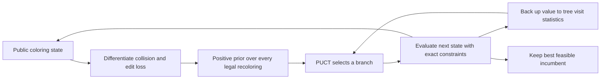

# Gradient-guided PUCT for public repair states

Status: **COLLECTED; ZERO FEASIBLE OUTPUTS, TREE DEPTH BELOW REQUIRED EDITS**

The [matched-timeout study](RND_HARD_REPAIR_TIMEOUT.md) exposed three failures:
constraint violations, feasible but nonminimal repairs, and no completed answer
within the token cap. A single gradient injection did not establish an advantage.
This pilot tests a different mechanism: recompute directional repair gains at
search nodes and use them as PUCT priors. It makes zero hosted requests and
does not change the production engine or any closed experiment source.

## Two different backward operations



Autograd differentiates an explicit public one-hot state. PUCT backup updates
visit counts and mean values along a sampled tree path; it does not differentiate
that path. Neither operation accesses a language model's hidden reasoning.

For n vertices, the relaxed loss is

`L(X) = sum_(u,v in all edges) dot(X_u, X_v) + sum_v (1 - X_v[original_color_v])/(n+1)`.

At one-hot states this is exactly `conflicts + edits/(n+1)`. One extra conflict
is worse than any possible improvement in edit count. The reference coloring
is always the original input, never the previous search node. All current
edges contribute, including presently satisfied edges that a move might break.
This differs from the earlier active-conflict-only feedback, which remains
unchanged. Fixed vertices cannot be recolored.

For action a changing v from c to d, define
`gain(a) = gradient[v,c] - gradient[v,d]` and
`P(a) = 0.1/|A| + 0.9*softmax(gain(a)/0.5)`.
Every nonfixed vertex and every alternative palette color remain eligible,
including zero-gradient vertices and immediately worsening moves. The positive
floor does not guarantee that a finite budget visits every action. Only
ancestor-state cycles are excluded. Reaching the same state through distinct
acyclic paths is allowed and charged again; there is no transposition cache.

For this bilinear coloring loss, the single-recolor directional derivative
equals the exact one-step energy change. Tests compare every action against
independent energy differences. This is a classical local heuristic expressed
with autograd, not evidence that gradients provide unique information beyond
constraint-based move scoring.

The tree score is

`Q(s,a) + 1.25 * P(s,a) * sqrt(1 + N(s)) / (1 + N(s,a))`.

Unvisited edges use the current state's value as Q. A new leaf has exact
heuristic value `1 - L/(number_of_edges+1)`; its value is backed up as a mean,
without alternating signs because this is single-agent optimization. There
are no random rollouts, learned value model, language-model proposals, or
oracle-completed leaves. Seeded shuffling breaks ties. PUCT priors are computed
once per expanded state, not copied from the root. Search retains the best
evaluated feasible assignment, separately from the best invalid diagnostic
state. An invalid state is never emitted as an accepted candidate. Feasible
incumbents do not stop further edit minimization.

## Fixed pilot comparison

Reuse the existing 24/36/48-vertex cases as development fixtures. Their known
exact optima are available to post-run grading only, not search inputs or stop
conditions. The search interface contains only nodes, palette, edges, original
colors, and fixed colors. Witnesses and other oracle fields are removed before
that interface; independent exact search runs after each trial for grading.

Compare three arms:

| Arm | Action choice | Tree | Gradient computations |
| --- | --- | --- | --- |
| Gradient greedy | Best strictly positive directional gain | None; stop at a local minimum | Recomputed at each step |
| Uniform PUCT | PUCT with uniform priors | Same PUCT and exact heuristic value | None |
| Gradient PUCT | PUCT with directional-gain priors | Same PUCT and exact heuristic value | Once per expanded node |

Each arm runs each case with tie-breaking seeds 7,19,43: 27 runs, nine per arm,
on three distinct problems. The arm order reverses for seed 19. Maximum search
evaluations are 2048 per run, including the root; maximum depth is 2*n and
maximum traversal attempts 4*2048. The entire block admits at most 55296 search
state evaluations and zero provider attempts. Greedy may stop early and spend
less than its cap. This is a matched evaluation ceiling, not matched actual
work, FLOPs, wall-clock time, or LLM token budget. Gradient calls, evaluations,
traversals, and time are reported separately. Post-run oracle and grade checks
are additional diagnostic work and do not guide search.

Primary endpoints: feasible and oracle-minimal outputs out of all nine planned
runs per arm, plus excess edits on feasible outputs. Retain all failures and
all case/seed rows. Record residual conflicts, best-state edit count, depth,
stopping cause, and work counters. No selecting the best seed, changing cases,
adding rollouts, retuning constants, or increasing budgets within this block.
Repeated tie-break seeds are not new independent problems. These previously
used fixtures are not a held-out benchmark and cannot establish broad gains.

```bash
python run_puct_repair_study.py plan --output /tmp/puct-pilot-plan.json
python run_puct_repair_study.py run --plan /tmp/puct-pilot-plan.json --output /tmp/puct-pilot-report.json
```

Freeze code and plan before running the hard cases. Plans bind source hashes,
configuration, schedule, fixture, and Torch version. Output files refuse
overwrite. Individual searches are deterministic for a fixed input/config;
elapsed-time measurements are not deterministic. Fingerprints bind stored
content, not independent proof of execution. Tests cover exact directional
gains, new-collision awareness, the immutable original-edit objective, positive
action coverage, PUCT scoring, cycle handling, bounds, seed replay, invalid
candidate rejection, and oracle-free input projection.
All 245 relevant network-zero tests passed before the hard-case pilot,
including eleven new PUCT tests. No hard-case search outcomes were used to
choose the frozen constants or change the comparison schedule.

## Executed pilot and diagnosis

Source `f1ad1a5702f3c30da20032587cb3a634ad126c2f` and the plan were fixed
before hard-case searches. All 27 runs completed on 2026-10-27 (Asia/Tokyo),
with zero provider requests. No constants, cases, seeds, or budgets were tuned
after seeing these results.

| Arm | Feasible | Minimal | State evaluations | Gradient calls | Search seconds, summed |
| --- | ---: | ---: | ---: | ---: | ---: |
| Gradient greedy | 0/9 | 0/9 | 109 | 109 | 0.071 |
| Uniform PUCT | 0/9 | 0/9 | 18432 | 0 | 2.024 |
| Gradient PUCT | 0/9 | 0/9 | 18432 | 7428 | 8.260 |

The two tree arms each spent all 2048 state evaluations on every run. Greedy
stopped at local minima after 7–17 evaluations. Total search evaluations were
36973 of the allowed 55296. Time covers search only, excluding post-run oracle
checks, and is one machine's measurement rather than a controlled speed study.
The gradient prior adds work; equal state counts are not equal computation.

All case/seed outcomes below are **residual conflicts / diagnostic edit count**
of the best invalid state. None is a valid answer or has a defined excess-edit
grade; a low edit count on an invalid assignment does not beat the optimum.

| Case | Seed | Gradient greedy | Uniform PUCT | Gradient PUCT |
| --- | ---: | ---: | ---: | ---: |
| hard-24 | 7 | 4 / 6 | 6 / 4 | 3 / 7 |
| hard-24 | 19 | 4 / 6 | 6 / 4 | 3 / 7 |
| hard-24 | 43 | 4 / 6 | 6 / 4 | 3 / 7 |
| hard-36 | 7 | 7 / 11 | 18 / 3 | 13 / 6 |
| hard-36 | 19 | 6 / 11 | 16 / 5 | 13 / 6 |
| hard-36 | 43 | 5 / 12 | 18 / 3 | 13 / 6 |
| hard-48 | 7 | 5 / 16 | 22 / 8 | 16 / 8 |
| hard-48 | 19 | 6 / 15 | 26 / 7 | 16 / 8 |
| hard-48 | 43 | 5 / 16 | 24 / 6 | 16 / 8 |

Gradient PUCT reduced residual conflicts versus uniform PUCT in all nine
matched rows. It was worse than cheap greedy repair on the 36- and 48-vertex
cases, and no arm found feasibility. This is a diagnostic improvement over
one weak tree baseline, not a solved-task or compute-efficiency advantage.

| Case | Minimum changed vertices in any feasible repair | Greedy depth | Uniform PUCT depth | Gradient PUCT depth |
| --- | ---: | ---: | ---: | ---: |
| hard-24 | 12 | 6 | 5–6 | 9 |
| hard-36 | 18 | 11–12 | 4–5 | 6 |
| hard-48 | 21 | 15–16 | 6–9 | 8 |

Every explored path was shorter than the minimum number of vertices that
must change. Since each edge recolors only one vertex, no evaluated state on
those paths could be feasible. This is a post-run diagnosis, not oracle-guided
pruning. The configured depth caps (48/72/96) were never reached, so merely
raising the depth cap would not fix the observed bottleneck. Within the state
budget, exploration stayed shallow. Uniform PUCT expanded all 46/70/94 root
actions; gradient PUCT expanded 17/45/25. The immediate-state value and broad
single-recolor tree have not provided enough useful lookahead here.

Independent raw-color checks confirmed every reported conflict/edit count.
All 27 searches replayed exactly, including work counters and incumbent traces,
under the saved configurations. Replay spent another 36973 state evaluations
as diagnostic work; these are not extra trials or added evidence of success.
The pilot is not promoted to the production engine.

```text
plan:   9aa759f1133504cc7f390e74ff3d1d3fc57aa4e7a81ba400d842a02a36eb9b8d
report: 5bbd469971214b58306d22beaee9aa066bfe2b4b6d98417d0ab1912c564097a3
verify: 721730b7388d6f9e97910c3b3c4ac0d93f82a716e975687a4c1dc46e8ef524bc
```

The plan, full report, and replay receipt remain in private 0600 files outside
the checkout. The original hosted blocks and their interpretations are intact.

## Next comparison specification (at pilot closure)

This specification is now implemented and evaluated in the separately frozen
[bounded-trajectory study](RND_PUCT_TRAJECTORY_STUDY.md). The pilot's original
results above are unchanged; the proposal below predates that follow-up.

Test a bounded local-repair trajectory as one tree edge. After the selected
single recoloring, allow at most seven further improving gradient steps: at
most eight actual recolorings per expansion. Recompute the gradient at each
step, retain the original edit reference, check every intermediate assignment,
and charge every evaluated state to the same 2048-evaluation cap. Ancestor
cycles remain excluded. Stop early if the shared budget or local improvement
runs out; never grant eight free evaluations per edge. The tree child is the
trajectory endpoint, while any feasible intermediate can update the incumbent.

Compare uniform versus gradient priors with this identical local-repair
operator on both sides, alongside their no-trajectory controls (a 2x2 design).
The uniform-prior trajectory arm also computes gradients for the common local
operator, so it must not be described as gradient-free. This separates the
effect of the prior from the effect of obtaining deeper candidate states.
Keep budgets and cases fixed in a new source-pinned block; do not rewrite this
pilot. Progressive widening is a separate possible intervention, not an
unmeasured adjustment to combine with the first trajectory comparison.

## Path to an LLM-assisted hybrid

Keep this pilot distinct from hosted inference. A later adapter could admit
parsed LLM proposals as bounded multi-vertex actions, score their public-state
directions, and validate each resulting assignment before incumbent updates.
Single-vertex gradients are exact here; their prediction for multi-vertex
actions can be wrong because edge cross-terms change too, so those actions
must still be evaluated. The exact graph oracle must never propose branches.

A hosted comparison should give both PUCT variants the same initial state,
proposal mechanism, feasibility checks, and total call/token ceilings; separate
proposal cost from state evaluations. A conflict-only prior and direct local
energy-difference prior would help distinguish useful localization from any
gradient-specific contribution. First use this offline result to determine
whether the tree policy supplies useful exploration under a small fixed budget.
